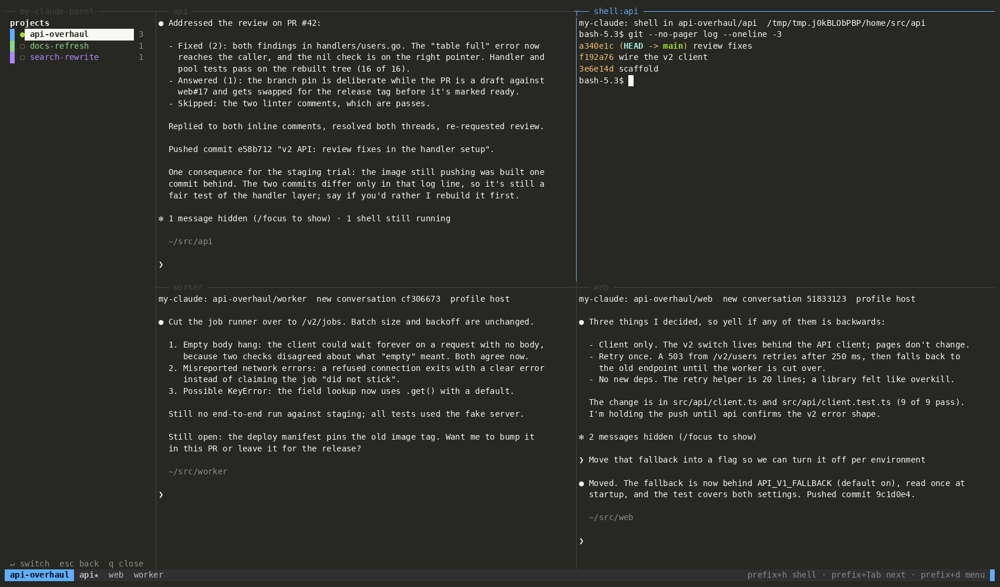
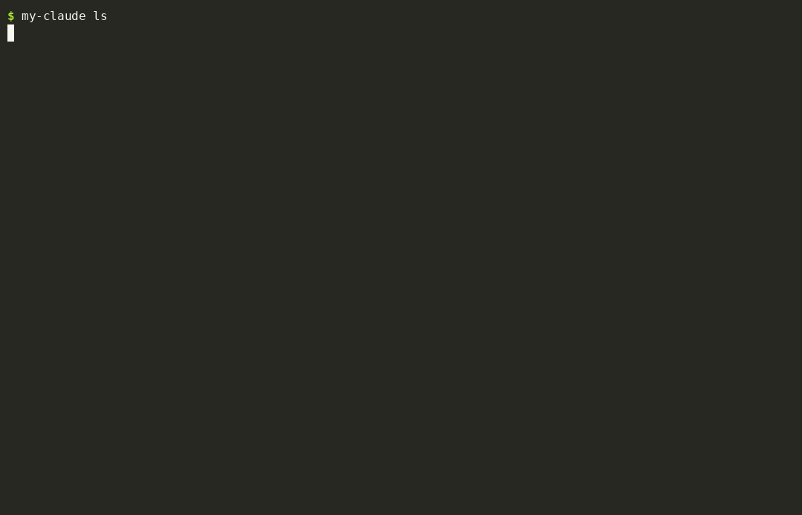
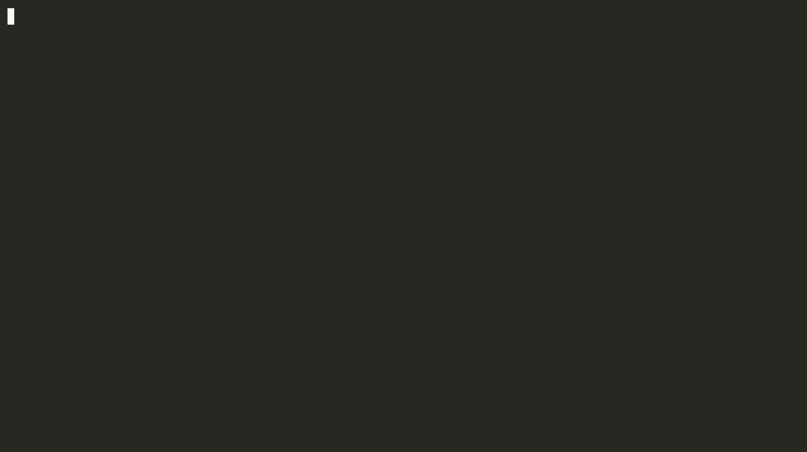

# my-claude

**Run a piece of work, not a directory.**

A *project* is a ticket, a feature, an overhaul: it usually spans several
repos. my-claude gives each repo its own long-lived Claude Code session (a
*peer*), lays them out as one tiled tmux session, wires them into a
claude-peers group so they can talk, and brings the whole set back on the same
conversations after the containers, the tmux server or the machine die.

One terminal. Drop in, drop out. Nothing lost.



A three-repo project. The side panel on the left lists every project (Enter
switches, `a` adds a repo); each Claude has its repo as a pane; the floating
pane is a `prefix+h` shell on the first peer; the status bar names the
project and its peers (★ = lead).


## Install

```bash
curl -fsSL https://raw.githubusercontent.com/JasonDictos/my-claude/main/install.sh | bash
```

That clones to `~/my-claude`, installs [bun](https://bun.sh) if you don't have
it, links `~/.local/bin/my-claude`, and seeds `~/.config/my-claude/config.json`.
Re-running updates. Needs `git`, `tmux` (3.2+), and `claude` (Claude Code) on PATH.

Manual: `git clone … ~/my-claude && cd ~/my-claude && bun install && ln -s $PWD/src/cli.ts ~/.local/bin/my-claude`.

## Thirty seconds

```bash
my-claude                                   # the menu
```

or from a shell:

```bash
my-claude new api-overhaul --color blue
my-claude add api-overhaul ~/src/api ~/src/web            # existing checkouts
my-claude add api-overhaul worker --branch v2             # fresh clone of <defaultOrg>/worker
my-claude add api-overhaul https://github.com/acme/billing/pull/42   # clone of that PR's branch
my-claude lead api-overhaul api "Move web and worker onto the v2 API."
my-claude up api-overhaul                                 # four panes, four Claudes; prefix+d to leave
```



## How it works

- **Projects** live in `~/my-claude/projects/<name>/project.json`: goal, lead,
  container mode, color, and per peer the repo path, role, model and
  **conversation id**. The id is allocated when the peer is added (an existing
  checkout adopts its most recent conversation) and never changes.
- **`up`** creates tmux session `mc-<name>` with one pane per peer and launches
  each peer through the project's *profile* (see below) as
  `claude --resume <id>` (first time: `--session-id <id>`), inside an
  interactive shell. Exit Claude (double Ctrl-C, `/exit`) and you're at that
  shell's prompt; `R` in the menu, or `up`, types `claude` back in. If the
  profile itself fails (a broken `dev.sh`, a missing image) the pane offers
  Enter to retry, `s` for a plain host shell in the checkout, `q` to close.
- **Liveness** is a fact about processes, not records: a peer is *live* when a
  `claude` process has its repo as cwd (compared by device:inode, so container
  and host paths agree). A repo held by a Claude my-claude didn't start is
  *occupied* and is never taken over silently.
- **`down`** kills the tmux session (containers started by it exit); the records
  and Claude's transcripts stay. **`up`** rebuilds and resumes. After a reboot,
  same thing. `up` also closes *stray* panes: ones titled for a repo that is no
  longer a peer. Remove peers with `x`/`rm`, not tmux's kill-pane, which kills
  the *active* pane, not the one you're looking at.
- **Lead + goal.** Nobody leads until you say so. `l` on a peer sets the lead
  and the goal together and briefs everyone through claude-peers: the lead
  gets the goal and the roster, each other peer gets who leads and what for.
- **Peers group.** Every project is a [claude-peers](https://github.com/JasonDictos/claude-peers-mcp)
  group named after it, kept in sync as peers come and go, so a Claude can
  `send <project> …` to reach the whole team.



## The menu

`my-claude` with no arguments. Keyboard only. Up/Down to move, Enter to open or
join, Esc (or Ctrl-C) to go back, `q` to quit. Text prompts remember what you
typed (Up/Down) and predict as you type (Tab or → accepts; for repos the
candidates are your history, git checkouts under `~`, and your org's repos).

**Projects screen:** `Enter` open · `n` new (name → container mode → color) ·
`u` up · `d` down · `x` delete (to `.trash/`, never `rm -rf`) · `U` undelete · plus any hotkeys
your profile adds.

**Project screen:** `Enter` join (tmux, that peer focused) · `a` add repos
(several on one line) · `l` lead+goal · `b` resend briefs · `m` model · `c`
color · `R` relaunch · `u`/`d` · `x` remove peer (closes its pane and the Claude in it). Live column: `●` live, `◐`
starting, `◌ shell` idle (Claude exited, shell still up), `○` down, `!` held
by a stranger (Enter offers take-over).

Menus open in several terminals stay in sync; the records are watched.

## Inside the tmux session

The status bar shows the project on its color and the peers (lead starred).
Four keys cover it; everything else is plain tmux.

- **The side panel** is the 30-column pane on the left of every project
  session: every project with its peers, your current ones in bold. It
  refreshes itself. **prefix+`** focuses it (or reopens it); inside, Up/Down
  *is* the switch: the highlighted project is the one on screen (a down
  project waits for Enter, which starts it). Enter drops into its panes, `a`
  adds repos to it (same specs as the menu; the new pane appears at once),
  Esc goes back to the pane you came from, `q` closes the panel. `"panel": false` in the config turns
  it off by default.
- **prefix+Tab / prefix+Shift+Tab** — next / previous project session.
- **prefix+h** — a shell *inside the highlighted peer's environment* (for a
  container profile: that exact container, found via the Claude process's
  cgroup), as a floating pane over the grid (tmux 3.8+; a split below on
  older tmux). Exit the shell to close it; tmux's prefix+@ docks it.
- **prefix+d** — detach; the menu comes back.
- tmux's own `prefix+z` zooms a pane, `prefix+o` cycles panes.

## Adding repos

One line, several specs, flags bind to the spec before them:

| you type | you get |
|---|---|
| `~/src/api` or `./api` | symlink `projects/<name>/api → ~/src/api`; peer runs in the real dir |
| `billing` | fresh clone of `<clone.defaultOrg>/billing` into `projects/<name>/billing` |
| `acme/billing --branch v2` | that repo on that branch |
| `git@github.com:acme/billing.git` | same |
| `https://github.com/acme/billing/pull/42` | clone of the PR's head branch |

A bare word is always a clone, even if a directory of that name is in your
cwd; paths need `/`, `./` or `~`. Re-adding a repo whose clone is still in the
project dir reuses it (and switches branch if asked). Fresh-clone paths are
pre-trusted in Claude Code so they open straight into the session.

## Profiles: your world, not mine

The core knows tmux, projects and Claude. **How** a peer's `claude` is started
(bare, in a container, over ssh…) is a *profile*. `host` ships: it runs
`claude` on this machine. Everything else lives outside the checkout in
`~/.config/my-claude/profiles/<name>.ts`:

```ts
import type { Profile, ProfileApi } from "/path/to/my-claude/src/profiles/types.ts";
export default function ({ run, out, shq, config, home }: ProfileApi): Profile {
  return {
    launch(ctx)  { /* run ctx.cmdline inside your environment; keep a shell up after */ },
    exec(ctx)    { /* shared mode, peers 2..n: run inside the container peer 1 started */ },
    containerReady(name) { return true; },
    shellInto(container, path) { /* prefix+h */ },
    paneEnv(project, repo) { return {}; },
    actions: [ /* optional hotkeys for the projects screen, e.g. "file a ticket, open a project" */ ],
  };
}
```

`ctx.cmdline` is the ready-made shell line
(`MY_CLAUDE_PROJECT=… MY_CLAUDE_PEER=… claude --resume …`); run it as
`bash -ic "<cmdline>; exec bash -i"` so the pane survives Claude exiting.
[`docs/profiles/example-docker.ts`](docs/profiles/example-docker.ts) is a
complete one for "each repo's own Dockerfile". Projects pick a profile at
creation (`--profile`, default from config).

## Configuration

`~/.config/my-claude/config.json` (see [`config.example.json`](config.example.json)):

```json
{
  "profile": "host",
  "clone":   { "defaultOrg": "acme" },
  "peers":   { "cli": "~/claude-peers-mcp/cli.ts" },
  "panel":   true,
  "docker":  { "anything": "your profile reads via config().docker" }
}
```

`peers.cli` is optional: without claude-peers, groups and briefs are skipped
and everything else works.

Environment: `MY_CLAUDE_ROOT` (checkout/data root, default the install dir),
`MY_CLAUDE_CONFIG_DIR` (default `~/.config/my-claude`).

## Every command

```
my-claude                              menu
my-claude new <p> [--shared] [--profile P] [--color C]
my-claude add <p> <spec>… [--model M]   see "Adding repos"
my-claude rm <p> <repo>                 (a clone stays on disk)
my-claude up <p> [--no-attach]          idempotent: launches what's missing, relaunches idle shells
my-claude attach <p> [repo]
my-claude down <p>
my-claude ls | status <p> [--json]
my-claude lead <p> <repo> [goal…]       sets lead + goal, briefs via claude-peers
my-claude brief <p>
my-claude set <p> <repo> [--model M|default] [--session <id|prefix>] [--role peer]
my-claude color <p> <color>
my-claude restart <p> <repo>            stop that claude, start it again in the same pane
my-claude takeover <p> <repo>           kill a stranger's claude on the repo, launch the peer
my-claude delete <p> [--force]          to .trash/
my-claude undelete [<p>]                bring it back; no arg lists .trash/
my-claude next | prev                   (bound to prefix+Tab / prefix+Shift+Tab)
my-claude shell-here                    (bound to prefix+h)
my-claude panel                         focus/open the side panel (bound to prefix+`)
```

`--shared` puts every peer of a project in **one** container (profile
permitting) so they share build state; the default is one per repo.

The status bar has two rows, both clickable with tmux's `mouse on`: the top
row lists every project that is up, the current one on its color (click to
switch); the second row is the current project's tabs, named by their repos
(click to select). Minimised shells sit as a taskbar of two-line strips along
the bottom edge of the window; click one to restore it.

Shells persist: prefix+h is a toggle. From a peer it opens that peer's shell as
a floating pane, or brings a minimised one back, centred and in front. From the
shell it minimises it to a two-line strip in the bottom-right corner, title on
the border, and returns you to the peer. Only `exit` ends the shell. (tmux has
no hidden state for a pane, so the strip is the minimise.)

Tabs: a window holds up to `panesPerWindow` peers (config.json, default 6);
the next one opens a second tmux window in the same session, with its own
panel column. The status bar then shows the tabs, each named by its repos;
prefix+n / prefix+p move between them, and a tab whose last peer is removed
closes by itself.

Mouse: with tmux's `mouse on`, clicking a row in the side panel goes to that
project and the wheel steps through them. (tmux reports no pointer motion, so
hovering cannot do anything.) Detaching with prefix+d lands the menu on the
project you were looking at, not the one you joined.

## Peers can start projects

Every peer's Claude gets a my-claude MCP server (`--mcp-config`, served by
`bin/my-claude mcp`). Its tools: `start_project` (name, repos, a written work
order; the lead gets it as goal and first prompt and starts at once),
`add_repos`, `list_projects`, `project_status`. The brief tells them to use
`start_project` instead of subagents when work deserves sessions of its own:
the result is durable, shows in the side panel, and the new lead knows which
session started it and reports back through claude-peers.

Inside a dev container there is no bun, so `bin/my-claude` runs the compiled
`dist/my-claude` there (`bun run build`; a project start rebuilds it when the
source is newer).

## Safety notes

- Deleting goes to `~/my-claude/.trash/<timestamp>-<name>/`. A fresh clone can
  hold work nothing else has. `undelete` moves it back under the same name and
  paths, so every peer picks up its old conversation (Claude keys them by
  directory); a clone whose directory is gone is cloned again from the origin
  recorded when it was added.
- Every peer's Claude starts knowing the project: its own repo, the other
  sessions and their paths, who leads, the goal, and the claude-peers group that
  reaches them all (`mc-<project>`, like the tmux session), and the tmux session and pane titles so it can read another
  peer's or a shell's screen when asked (`--append-system-prompt`). Claude Code snapshots that per
  conversation, so later roster changes and `lead` briefs arrive as peer messages.
- The side panel and both menu screens show when a Claude needs you: red `!`
  when it is waiting on a permission or a question, yellow `✉` when its turn is
  done and it sits idle for the next prompt. Claude Code hooks injected per
  launch (`--settings`) keep a one-word file per peer under
  `projects/<name>/.attn/`; typing a prompt or a tool running clears it.
- `up` never kills a Claude it didn't start; take-over is explicit.
- Error messages never echo command lines (pane environments carry tokens).
- Conversation ids are the durable handle; transcripts are Claude Code's own
  under `~/.claude/projects/`.

## Development

TypeScript on bun, no build step. The menu is [Ink](https://github.com/vadimdemedes/ink),
the same terminal UI library Claude Code renders with.

```bash
bun run typecheck
bun run test          # tests/smoke.sh: host profile, fake claude, private tmux server
tests/demo.sh         # re-record docs/demo/*.gif and docs/screenshot.png (asciinema + agg + imagemagick)
```

Layout: `src/cli.ts` (commands + menu loop) · `src/core.ts` (operations) ·
`src/store.ts` (records) · `src/live.ts` (liveness) · `src/tmux.ts` ·
`src/peers.ts` (claude-peers) · `src/profiles/` · `src/menu/`.

## License

MIT, © 2026 Jason Dictos.
