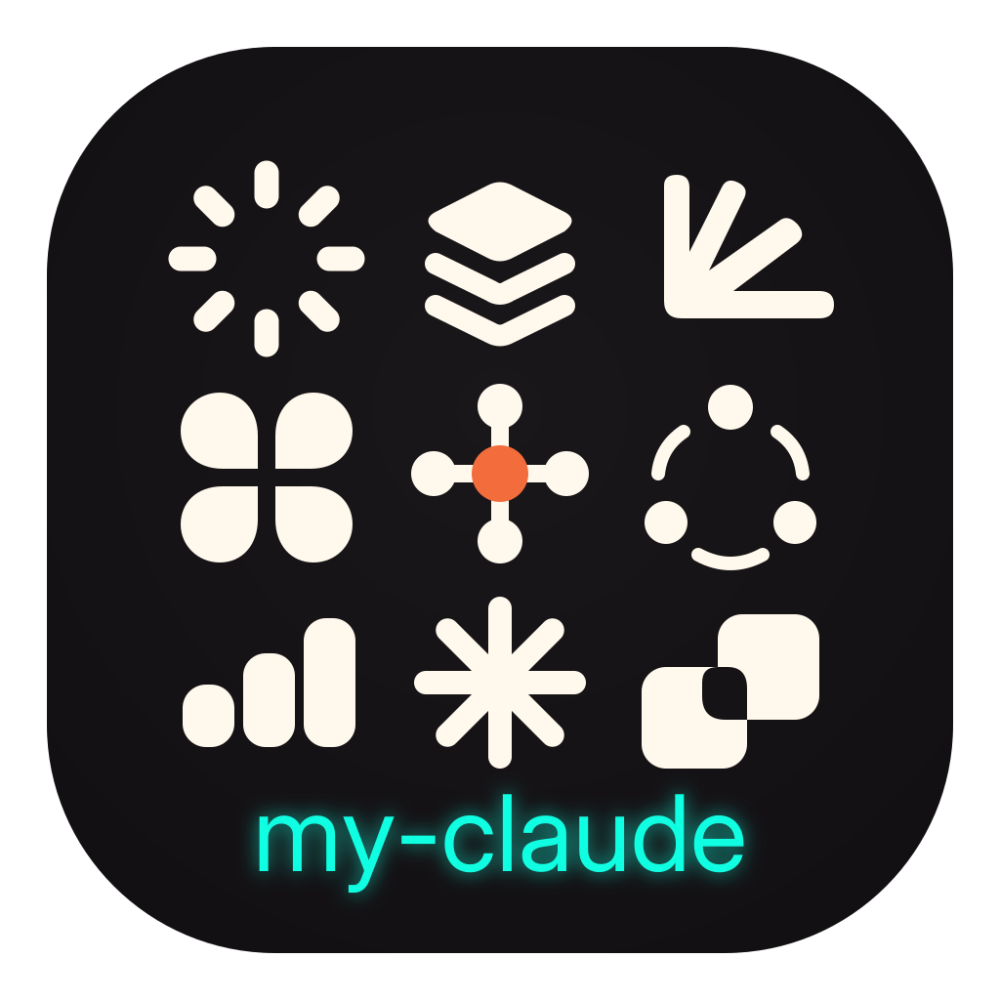
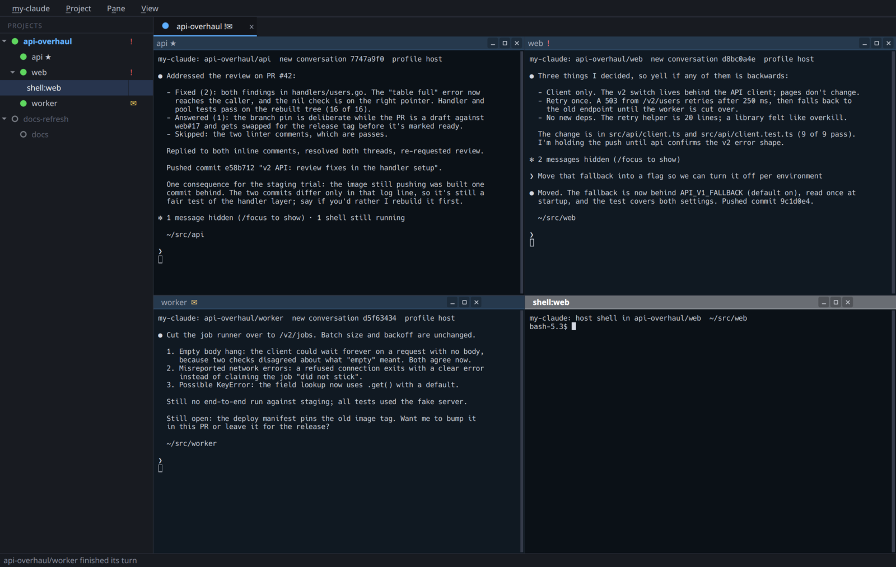
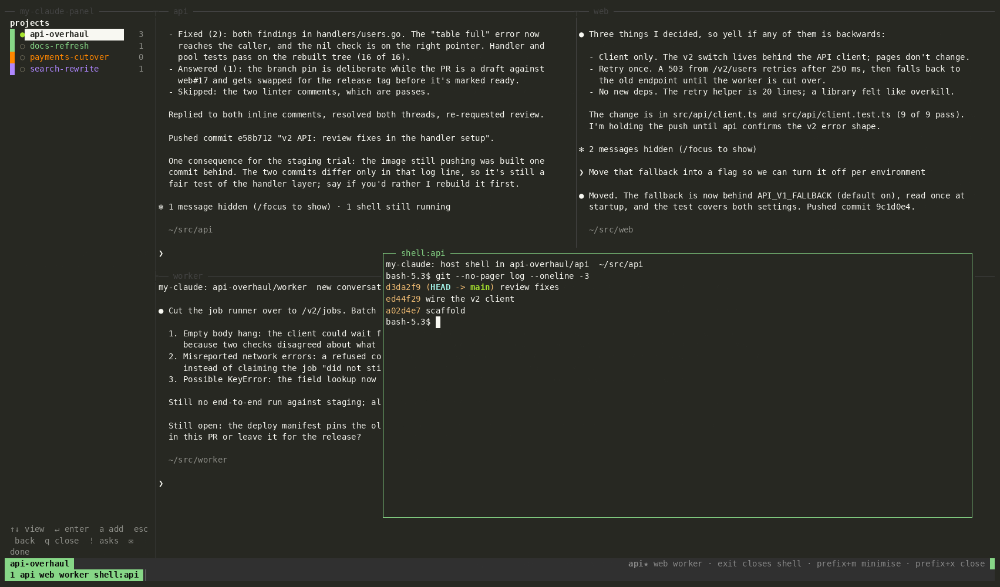
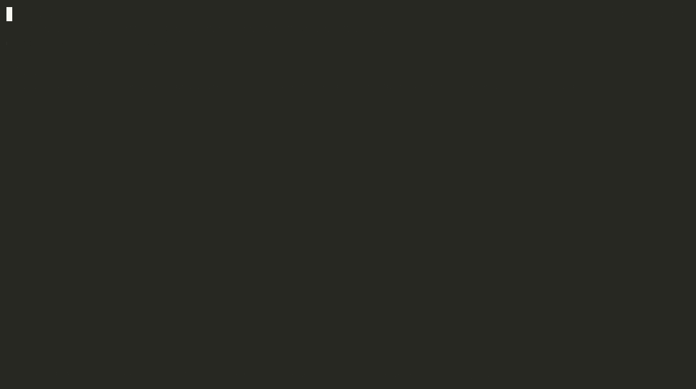
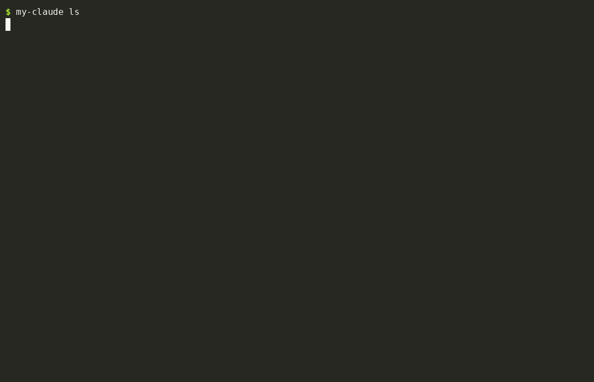
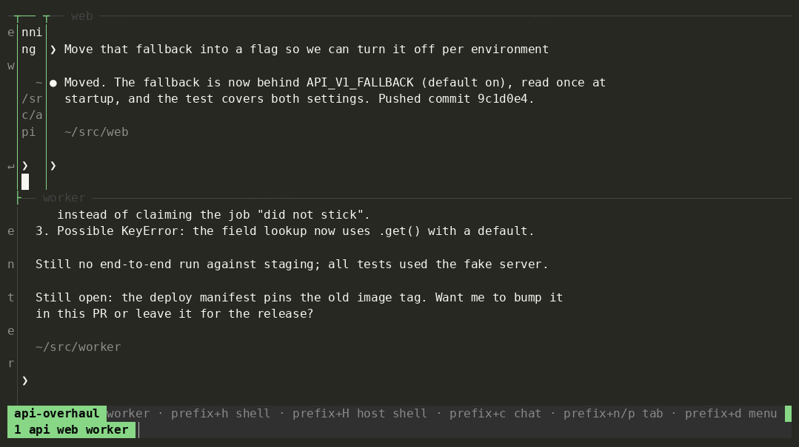
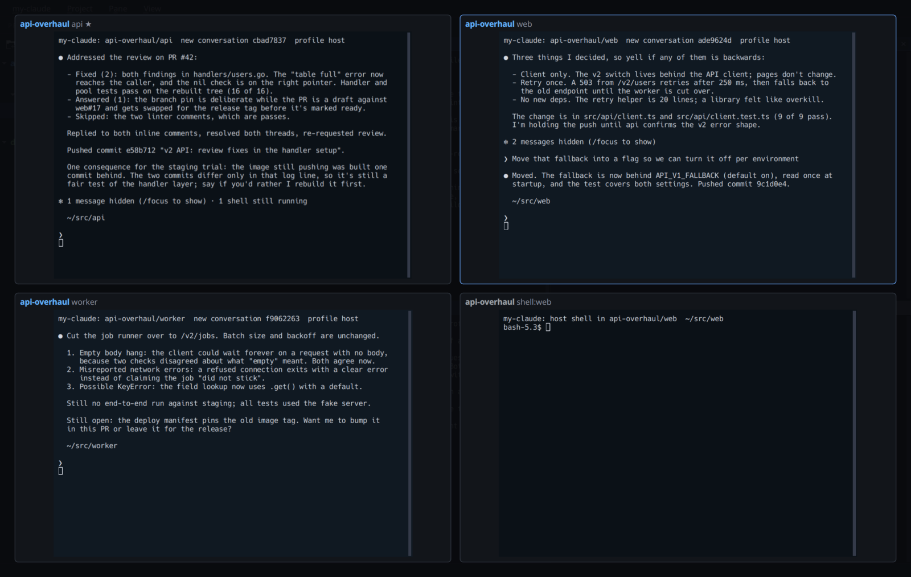

<p align="center">
  
</p>

<h1 align="center">my-claude</h1>

<p align="center">
  <b>Run a piece of work, not a directory.</b><br>
  One Claude Code per repo, a whole team per project, and a home for all of them<br>
  that survives reboots, crashes and you walking away.
</p>

<p align="center">
  <a href="#install">Install</a> ·
  <a href="#thirty-seconds">Thirty seconds</a> ·
  <a href="#the-native-window">The native window</a> ·
  <a href="#other-machines">Other machines</a> ·
  <a href="#profiles-your-world-not-mine">Profiles</a>
</p>

---

Real work doesn't live in one repo. A ticket touches the API, the web app and the worker;
an overhaul touches ten. **my-claude** makes the *project* the unit: give it a goal and a
handful of repos, and each repo gets its own long-lived Claude Code session (a *peer*).
The peers sit side by side, know about each other, can message each other, and come
back on the same conversations after the containers, tmux or the machine itself go down.

- **One project, one place.** Every peer of a project in one view, a colour of its own,
  and a status at a glance: working, waiting on you, done.
- **They talk.** Peers join a [claude-peers](https://github.com/JasonDictos/network-claude-peers-mcp)
  group, so the API agent can tell the web agent the error shape changed. You can join
  the chat too.
- **Nothing is lost.** Conversations are resumed by id; a crashed pane relaunches on the
  same session; a deleted project goes to the trash, not away.
- **Two faces.** A tmux layout with a side panel for the terminal, or a native desktop
  window with tabs, a project tree and real terminals: unlimited scrollback, your font,
  your clipboard.
- **Every machine in one window.** Connect the machines you can ssh to and their projects
  sit beside this one's as `project@machine`. `my-claude deploy` puts my-claude on one.
- **Your world, not mine.** Containers, dev shells, ticket systems: a small profile
  file says how *your* repos start, outside this repo.

<p align="center">
  
  <br><sub>The native window: <code>api-overhaul</code> is a tab, each repo's Claude a pane, a host shell on <code>web</code> beside them. The list groups the projects by machine, with the operations over it; ! asks for you, ✉ has finished its turn.</sub>
</p>

And the same projects in tmux, for when a terminal is all there is:



A three-repo project. The side panel on the left lists every project (Enter
switches, `a` adds a repo); each Claude has its repo as a pane; the floating
pane is a `prefix+h` shell on the first peer; the status bar names the
project and its peers (★ = lead).



## Install

Packages from the [latest release](https://github.com/JasonDictos/my-claude/releases) bring
the window and everything it needs (tmux, git, Qt 6, qtermwidget):

```bash
# Fedora 44
sudo dnf install https://github.com/JasonDictos/my-claude/releases/download/v0.0.3-alpha/my-claude-0.0.3-0.1.alpha.fc44.x86_64.rpm
# Ubuntu 26.04 / Debian
curl -LO https://github.com/JasonDictos/my-claude/releases/download/v0.0.3-alpha/my-claude_0.0.3-alpha_amd64.deb
sudo apt install ./my-claude_0.0.3-alpha_amd64.deb
```

Projects then live in `~/.local/share/my-claude`.

**Another machine of yours:** from one that has my-claude, `my-claude deploy you@server`
sends it over ssh into `~/.local` there, window included, no root needed (see
[Other machines](#other-machines)).

**From source** (any Linux). For the window there, either build it against Qt 6 and
qtermwidget (`my-claude gui --build`), or take the self-contained one from the release:
`curl -Lo ~/.local/bin/mc-term https://github.com/JasonDictos/my-claude/releases/download/v0.0.3-alpha/mc-term-0.0.3-alpha-x86_64-linux && chmod +x ~/.local/bin/mc-term`.

```bash
curl -fsSL https://raw.githubusercontent.com/JasonDictos/my-claude/main/install.sh | bash
```

That clones to `~/my-claude`, installs [bun](https://bun.sh) if you don't have
it, links `~/.local/bin/my-claude`, and seeds `~/.config/my-claude/settings.json`.
Re-running updates. Needs `git`, `tmux` (3.2+), `curl`, `unzip` (bun's installer uses it) and `claude` (Claude Code); the script says what is missing and how to get it.

Manual: `git clone … ~/my-claude && cd ~/my-claude && bun install && ln -s $PWD/bin/my-claude ~/.local/bin/my-claude`.

## Thirty seconds

```bash
my-claude                                   # the menu
```

or from a shell:

```bash
my-claude new api-overhaul --color blue
my-claude add api-overhaul ~/src/api ~/src/web            # existing checkouts
my-claude add api-overhaul worker --branch v2             # fresh clone of <defaultOrg>/worker
my-claude add api-overhaul https://github.com/acme/billing/pull/42   # clone of that PR's branch
my-claude lead api-overhaul api "Move web and worker onto the v2 API."
my-claude up api-overhaul                                 # four panes, four Claudes; prefix+d to leave
```



## How it works

- **Projects** live in `projects/<name>/project.json` under the data root
  (`~/.local/share/my-claude` from the RPM or `deploy`, the checkout from source): goal, lead,
  container mode, color, and per peer the repo path, role, model and
  **conversation id**. The id is allocated when the peer is added (an existing
  checkout adopts its most recent conversation) and never changes.
- **`up`** creates tmux session `mc-<name>` with one pane per peer and launches
  each peer through the project's *profile* (see below) as
  `claude --resume <id>` (first time: `--session-id <id>`), inside an
  interactive shell. Exit Claude (double Ctrl-C, `/exit`) and you're at that
  shell's prompt; `R` in the menu, or `up`, types `claude` back in. If the
  profile itself fails (a broken container script, a missing image) the pane offers
  Enter to retry, `s` for a plain host shell in the checkout, `q` to close.
- **Liveness** is a fact about processes, not records: a peer is *live* when a
  `claude` process has its repo as cwd (compared by device:inode, so container
  and host paths agree). A repo held by a Claude my-claude didn't start is
  *occupied* and is never taken over silently.
- **`down`** kills the tmux session (containers started by it exit); the records
  and Claude's transcripts stay. **`up`** rebuilds and resumes. After a reboot,
  same thing. `up` also closes *stray* panes: ones titled for a repo that is no
  longer a peer. Remove peers with `x`/`rm`, not tmux's kill-pane, which kills
  the *active* pane, not the one you're looking at.
- **Lead + goal.** Nobody leads until you say so. `l` on a peer sets the lead
  and the goal together and briefs everyone through claude-peers: the lead
  gets the goal and the roster, each other peer gets who leads and what for.
- **Peers group.** Every project is a [claude-peers](https://github.com/JasonDictos/network-claude-peers-mcp)
  group named after it, kept in sync as peers come and go, so a Claude can
  `send <project> …` to reach the whole team.



## The menu

`my-claude` with no arguments. Keyboard only. Up/Down to move, Enter to open or
join, Esc (or Ctrl-C) to go back, `q` to quit. Text prompts remember what you
typed (Up/Down) and predict as you type (Tab or → accepts; for repos the
candidates are your history, git checkouts under `~`, and your org's repos).

**Projects screen:** `Enter` open · `n` new (name → container mode → color) ·
`u` up · `d` down · `x` delete (to `.trash/`, never `rm -rf`) · `U` undelete · plus any hotkeys
your profile adds.

**Project screen:** `Enter` join (tmux, that peer focused) · `a` add repos
(several on one line) · `l` lead+goal · `b` resend briefs · `m` model · `c`
color · `R` relaunch · `u`/`d` · `x` remove peer (closes its pane and the Claude in it). Live column: `●` live, `◐`
starting, `◌ shell` idle (Claude exited, shell still up), `○` down, `!` held
by a Claude my-claude did not start, say one you opened in a terminal (Enter offers to take
it over: that session ends and its conversation carries on in the pane).

Menus open in several terminals stay in sync; the records are watched.

## Inside the tmux session

The status bar shows the project on its color and the peers (lead starred).
Four keys cover it; everything else is plain tmux.

- **The side panel** is the 30-column pane on the left of every project
  session: every project with its peers, your current ones in bold. It
  refreshes itself. **prefix+`** focuses it (or reopens it); inside, Up/Down
  *is* the switch: the highlighted project is the one on screen (a down
  project waits for Enter, which starts it). Enter drops into its panes, `a`
  adds repos to it (same specs as the menu; the new pane appears at once),
  Esc goes back to the pane you came from, `q` closes the panel. `"panel": false` in the config turns
  it off by default.
- **prefix+Tab / prefix+Shift+Tab** — next / previous project session.
- **prefix+h** — a shell *inside the highlighted peer's environment* (for a
  container profile: that exact container, found via the Claude process's
  cgroup), as a floating pane over the grid (tmux 3.8+; a split below on
  older tmux). Exit the shell to close it; tmux's prefix+@ docks it.
- **prefix+H** — a plain shell on the host, in the peer's checkout. prefix+h also
  falls back to this, and says so, while the peer's environment is not up yet
  (its claude has not started, so there is no container to enter).
- **prefix+c** — a floating chat with every peer of the project: you join the
  claude-peers group as a peer of your own (named after `chat.name` in
  settings.json, default `$USER-chat`), each line you type goes to the group, and
  replies print as they arrive. Ctrl-D or `/quit` leaves and drops you from
  the group again. The agents are told in their brief that messages from that
  name are the user speaking.
- **prefix+m** (in a floating shell) — minimise it to a two-line strip along the bottom;
  click the strip to restore it. Shells persist until you `exit` them.
- **prefix+x** — on a peer's pane, remove that peer (as `x` in the panel); on anything
  else, close it.
- **prefix+d** — detach; the menu comes back, on the project you were looking at.
- tmux's own `prefix+z` zooms a pane, `prefix+o` cycles panes.

The status bar has two clickable rows (tmux `mouse on`): every project that is up, the
current one on its colour, then the current project's tabs. A window holds up to
`panesPerWindow` peers (default 6); more open further tabs, prefix+n / prefix+p move
between them. Right-click anywhere in a project opens my-claude's menu in place of
tmux's: shell, relaunch, remove, add repo, and every other project. Clicking a row of the
side panel goes to that project, and the wheel steps through them.

## The native window

`my-claude --install` puts it in your desktop's application menu (Development).
`my-claude gui` opens the same projects in a window of their own instead of inside one
terminal: a Qt app (`host/`, needs Qt 6 and qtermwidget) driven by my-claude.

```bash
my-claude gui              # build on first use, open (or raise) the window
my-claude --install        # in the application menu (Development) and launcher search, and
                           # Ctrl+Alt+T: show it in front, or hide it (gui.toggleKey)
tests/gui-demo.sh          # try it in a sandbox: temp HOME, fake claude, private tmux
```

- **Tabs are projects.** `Ctrl+Tab` goes to the next one. Each has a colour: a dot on
  its tab, and a faint tint of it in the background of its terminals.
- **Panes are its repos and agents**, plus the shells and the chat you open. At most
  four are on screen (`gui.panesPerGroup`); a project with more shows them in groups,
  listed under the grid. `Ctrl+Shift+Tab` walks through every pane, group after group.
  Neighbouring panes take two shades, so it shows where one ends.
- **The list on the left** is grouped by machine ("PROJECTS @ host"), every project with its
  repos and shells under it, each with an icon for where it runs (a console, or a docker
  console). Rest the mouse on one to see its terminal live; **F2** renames it (empty: its
  default name again). It marks
  the pane the keyboard is in; walking it (`` Ctrl+` ``, arrows) brings what it points at
  on screen, Enter or a click goes there, a double-click on a stopped project starts it.
  Each entry's menu (right-click, or its letter) is what the old menu had.
- **The terminals are real ones.** The window is each tmux pane's terminal (through a
  tmux control client), so scrolling, selecting, searching (`Ctrl+Shift+F`) and copying
  are the window's own, `Ctrl-b` reaches the program, and nothing of tmux is drawn.
  Closing the window ends nothing: the Claudes keep running in tmux, `my-claude attach`
  still works, and the next `my-claude gui` shows them where they are.
- **Every pane has `_ [] X`** in its header: minimise (the others close up to fill the
  space; it waits as a button under the grid), maximise (or double-click the header),
  close. Right-click a pane for its own colour scheme; its text size (`Ctrl+=`) is its own
  too. Both are remembered per project.
- **F1** shows a bar of every key for what has the focus; holding it labels each part of
  the window with its keys. **Alt** brings back a hidden menu bar (right-click the bar or
  the PROJECTS caption: Persist menu bar).
- **Consoles** (`Ctrl+Shift+N`): plain shells on the machine of the tab in front, named
  console1, console2… (unique: rename one by double-clicking its tab). They share one
  panel that floats over the project, always on top, with a tab each; drag it by its title,
  size it from its corner, minimise it to its title or maximise it. Closing the panel only
  takes it off that project; the consoles live on (in tmux, `my-claude-consoles`).
  Pinned, the panel shows over every project. The list has one Consoles entry per machine.
- **The overview** (`Meta+Shift+W`): every open terminal at once, live; click one to go there.

  

- **Dropdown mode** (Settings → Window, Guake style): the window is always full screen,
  hides when another window takes the focus, and Ctrl+Alt+T brings it back.
- **Scrollback is unlimited** by default and lives on disk
  (`~/.cache/my-claude/scrollback`), not in memory. tmux keeps its own, bounded
  (`historyLimit`, 50,000 lines a pane: about 40 MB each at most), which is what a new
  window starts from and what agents read.

Keys, all changeable in Settings → Shortcuts, a table of every action: its key, a key of
your own (click the cell, press the keys; Esc clears it) and whether it is on. A key another
action has is asked about, and that action turned off; a key the desktop holds (KDE's
global shortcuts) is refused, since it would never reach the window. Stored as `gui.keys`
(your own keys) and `gui.keysOff` in `settings.json`:

| | |
|-|-|
| `Ctrl+Tab` | next project |
| `Ctrl+Shift+Tab`, `Ctrl+Shift+O` / `P` | next / previous pane, across groups |
| `Ctrl+Shift+N` | a new console on this machine (Console menu: show/hide, next, pin, rename) |
| `Ctrl+Shift+arrows` | the pane in that direction |
| `` Ctrl+` ``, `Ctrl+Shift+D` | to the project list and back |
| `Ctrl+H` | show/hide the project list |
| `Ctrl+Shift+H` / `Ctrl+Alt+H` | a shell in the pane's environment / on the host, in its checkout |
| `Super+C` | chat with the project's peers |
| `Ctrl+Shift+Z`, `Ctrl+M` | maximise, minimise |
| `Ctrl+W`, `Ctrl+Shift+X` | close the pane, or remove the peer |
| `Ctrl+Shift+R` | relaunch a peer |
| `Ctrl+Shift+C`, `Ctrl+Shift+V` | copy, paste (selecting text copies it too; right-click → Paste) |
| `Ctrl+Shift+F` | find in scrollback |
| `F2` (in the list) | rename the entry |
| `Ctrl+=` / `Ctrl+-` / `Ctrl+0` | this pane's text bigger / smaller / normal (`Ctrl+Shift+` the same for all panes) |
| `Shift+PgUp/PgDn`, the wheel | scroll |
| `F1` (hold it: on the window) | every key |
| `F11`, `Ctrl+Shift+Q` | full screen, quit |
| `Meta+Shift+W` | the overview: every terminal at once |
| `Ctrl+Alt+T` (anywhere, after `--install`) | show the window in front, or hide it |

Settings (my-claude → Settings…, or `gui` in `settings.json`): `font`, `fontSize`,
`scheme` (a named qtermwidget scheme instead of the tinted one), `tint` (0-100),
`alternate`, `transparency` (0-95, with `blur`), `panesPerGroup`, `scrollback` (0:
unlimited), `seedLines` (how much of tmux's scrollback a pane starts with, 50000),
`copyOnSelect`, `clipboardFromPrograms`, `openOnStart`, `keepSolo`, and
`panes: "view"` to fall back to tmux drawing each pane itself.

While a project has a tab, its tmux session is laid out one pane per window (the window
draws the grid); close the tab and it is handed back as the terminal UI's tiled layout.
[`host/PROTOCOL.md`](host/PROTOCOL.md) is what the window and my-claude say to each other.

## Other machines

**Every machine in one window.** my-claude → Connect lists your saved machines (Manage
machines… keeps them like a terminal program's saved sessions: host, user, port, private
key, jump host). Picking one adds its projects to this window as `project@machine`, their
panes reached through that machine's tmux over ssh; Disconnect takes them out again, and
they keep running there. Each saved machine also gets a "my-claude <name>" launcher in
the application menu, which opens this window with that machine connected. New project
asks where it should run, checking each saved machine first (✓ with its my-claude
version, or ✗ and why).

**Putting my-claude on a machine:** `my-claude deploy you@server` (or Manage machines →
Deploy) compiles it here and sends it over ssh into `~/.local` there, with the window and
the daemon's service. Nothing is built there and no root is needed; the machine needs
tmux, git and claude.

The window is drawn where you sit (your fonts, clipboard and scrollback); the driver and
tmux run there, over one ssh connection. What crosses the wire is text, and a dropped
connection is taken up again. Either face also works on its own against one machine:

```bash
my-claude gui --remote you@server [--port N]            # a window for that machine alone
my-claude --remote you@server                           # its menu, in this terminal
my-claude --remote you@server attach api-overhaul       # its tmux session
```

**On the server**, an sshd you can reach (a public IPv6 address will do) with your key
in `authorized_keys` is the whole setup. For a key that should do nothing else:

```bash
my-claude remote                       # sshd, password logins, public IPv6, allowed keys
my-claude remote allow laptop.pub      # that key may open the window, and nothing else
```

An allowed key is bound to a gate (`_remote-gate`, `restrict`ed): it runs my-claude's
driver, tmux clients for my-claude's sessions and the few my-claude commands the window
sends; no shell, no pty, no forwarding of any kind. The panes are your shells and
Claudes, though: hand the key out as you would your account. `my-claude remote revoke
laptop` takes it back; on the laptop, `my-claude remote key` prints the key to allow.
Or let the daemon be the endpoint (next section) and keep sshd closed to the world.

## The daemon

```bash
my-claude service install     # turn it on: a systemd user service (the RPM ships the unit)
```

`my-claude daemon` owns the projects' state. It knows which should be up (`up` marks a
project running, `down` marks it stopped) and which are, brings back what fell over
(after a reboot, or when the tmux server dies) on the same conversations, and carries out
the CLI's `up`/`down` one change at a time. It starts the tmux server
in a systemd scope of its own, so restarting some other service that happened to start
tmux first no longer takes every project with it.

With `"daemon": {"ssh": {"port": 2222}}` in `settings.json` it is also an SSH server of its own, for
the window: keys from `~/.config/my-claude/authorized_keys` (`my-claude remote allow
<key>` adds one), and nothing offered but what the gate above lets through, plus a status
line. No shell, no pty, no tunnels. Save the machine with port 2222, or:

```bash
my-claude gui --remote you@host --port 2222
```

## Adding repos

One line, several specs, flags bind to the spec before them:

| you type | you get |
|---|---|
| `~/src/api` or `./api` | symlink `projects/<name>/api → ~/src/api`; peer runs in the real dir |
| `billing` | fresh clone of `<clone.defaultOrg>/billing` into `projects/<name>/billing` |
| `acme/billing --branch v2` | that repo on that branch |
| `git@github.com:acme/billing.git` | same |
| `https://github.com/acme/billing/pull/42` | clone of the PR's head branch |

A bare word is always a clone, even if a directory of that name is in your
cwd; paths need `/`, `./` or `~`. Re-adding a repo whose clone is still in the
project dir reuses it (and switches branch if asked). Fresh-clone paths are
pre-trusted in Claude Code so they open straight into the session.

## Profiles: your world, not mine

The core knows tmux, projects and Claude. **How** a peer's `claude` is started
(bare, in a container, over ssh…) is a *profile*. `host` ships: it runs
`claude` on this machine. Everything else lives outside the checkout in
`~/.config/my-claude/profiles/<name>.ts`:

```ts
import type { Profile, ProfileApi } from "/path/to/my-claude/src/profiles/types.ts";
export default function ({ run, out, shq, config, home }: ProfileApi): Profile {
  return {
    launch(ctx)  { /* run ctx.cmdline inside your environment; keep a shell up after */ },
    exec(ctx)    { /* shared mode, peers 2..n: run inside the container peer 1 started */ },
    containerReady(name) { return true; },
    shellInto(container, path) { /* prefix+h */ },
    paneEnv(project, repo) { return {}; },
    actions: [ /* optional hotkeys for the projects screen, e.g. "file a ticket, open a project" */ ],
    brief(ctx) { return [ /* optional extra lines for every peer's system prompt: what your world knows */ ]; },
  };
}
```

`brief(ctx)` runs at each launch with `{project, repo, path, goal, ticket}`
and its lines land at the end of the peer's brief. It is the place for what
only your world knows: where installed libraries keep their indexes, the
tracker's current sprint, the text of the ticket the project is for. Keep it
quick (it is synchronous) and cache what you fetch.

`ctx.cmdline` is the ready-made shell line
(`MY_CLAUDE_PROJECT=… MY_CLAUDE_PEER=… claude --resume …`); run it as
`bash -ic "<cmdline>; exec bash -i"` so the pane survives Claude exiting.
[`docs/profiles/example-docker.ts`](docs/profiles/example-docker.ts) is a
complete one for "each repo's own Dockerfile". Projects pick a profile at
creation (`--profile`, default from config).

## Configuration

`~/.config/my-claude/settings.json` (see [`settings.example.json`](settings.example.json)); the daemon's part sits in a `daemon` section, which `/etc/my-claude/settings.json` (the machine's, set by an admin) overrides:

```json
{
  "profile": "host",
  "clone":   { "defaultOrg": "acme" },
  "peers":   { "cli": "~/claude-peers-mcp/cli.ts" },
  "panel":   true,
  "docker":  { "anything": "your profile reads via config().docker" },
  "gui":     { "remote": "", "panesPerGroup": 4 },
  "daemon":  { "autoRestart": true, "ssh": { "port": 2222, "listen": "::" } }
}
```

`peers.cli` is optional: without claude-peers, groups and briefs are skipped
and everything else works.

Also: `historyLimit` (lines of scrollback tmux keeps for each pane my-claude starts,
default 50000; 0 leaves tmux's own setting), `shell.login` (default true: shells on the
host are login shells, so they read your profile), and `gui` (the native window, above).

Environment: `MY_CLAUDE_ROOT` (checkout/data root, default the install dir),
`MY_CLAUDE_CONFIG_DIR` (default `~/.config/my-claude`).

## Every command

`my-claude --help`:

```
usage: my-claude [cui] [--remote user@host] <command> [args]   (no command: the menu)
  new    <project> [--goal TEXT] [--shared] [--profile P] [--color blue|orange|green|purple|red|yellow|teal|pink] [--ticket KEY]
  add    <project> <spec> [<spec>...] [--model M]
         spec: <path> | <repo> | <org>/<repo> | <git url> | <PR url>, each with optional --branch B --name N
         a path is symlinked into projects/<project>/; anything else is cloned there fresh
  rm     <project> <repo>                remembered: readd puts it back with the same path and conversation
  readd  <project> [<repo>]              re-add a removed repo (no repo: list what was removed)
  up     <project> [--no-attach]
  attach <project> [<repo>]
  down   <project>
  ls     [--json]
  status <project> [--json]
  lead   <project> <repo> [GOAL TEXT]    set the lead (and the goal), brief everyone via claude-peers
  brief  <project>                       resend the briefs
  ticket <project> [KEY|-]               set (or clear) the tracker ticket the project is for; briefed to every peer
  color  <project> <color>
  set    <project> <repo> [--role peer] [--model M|default] [--session <id or prefix>]
  index  <project> [<repo>]              rebuild the ctags symbol index (automatic at launch)
  restart  <project> <repo>              stop the peer's claude and start it again in the same pane, same conversation
  takeover <project> <repo>              kill the stranger occupying the repo, launch the peer
  delete <project> [--force]             down + move the project dir to .trash/ (conversations kept)
  undelete [<project>]                   bring a deleted project back; no project: list .trash/
  layout <project> [grid|solo]           grid: tiled tmux windows and the side panel (the terminal UI);
                                         solo: one pane per window, as the window shows it

  gui    [--remote user@host [--port N] [--identity F] [--jump H]]   the window, for this machine or that one
  gui    --remote … --save                connect that machine to this machine's window from now on
  gui    --remote … --pin [--name N] | --unpin N  save that machine, with a "my-claude <name>" launcher
  gui    --connect <name>                this machine's window, with that saved machine's projects in it
  gui    --toggle | --build              show or hide the window full screen / rebuild it
  --install | --uninstall                the window in the desktop's application menu, with its show/hide key
  deploy user@host[:port] [--identity F] [--jump H] [--no-service]   put my-claude on that machine (~/.local, no root)
  daemon                                 owns the projects' state, brings back what fell over, optional ssh endpoint
  service [install|uninstall|status]     the daemon as a systemd user service
  remote [status]                        this machine as the far side: sshd, public IPv6, allowed keys
  remote allow <key> [--name N] | revoke <name> | list   which keys may open the window for this machine
  remote key [--make]                    this machine's public key, to allow on a server
  --version

  from inside a project's tmux session (bound to its keys):
  next | prev                            the next/previous project session (prefix+Tab / prefix+Shift+Tab)
  panel                                  focus or open the side panel (prefix+`)
  shell-here [--host]                    a shell in the peer's environment (prefix+h), or on the host (prefix+H)
  shell-min                              minimise a floating shell to a strip at the bottom (prefix+m)
  chat                                   a floating chat with the project's peers (prefix+c)

  mcp                                    the MCP server every peer gets (start_project, add_repos, …)
  build                                  compile dist/my-claude, what dev containers run (automatic at project start)
  keepalive [--once]                     bring back what is down and was not brought down on purpose (the daemon does this)
```

`--shared` puts every peer of a project in **one** container (profile
permitting) so they share build state; the default is one per repo.

## Peers can start projects

Every peer's Claude gets a my-claude MCP server (`--mcp-config`, served by
`bin/my-claude mcp`). Its tools: `start_project` (name, repos, a written work
order; the lead gets it as goal and first prompt and starts at once),
`add_repos`, `list_projects`, `project_status`. The brief tells them to use
`start_project` instead of subagents when work deserves sessions of its own:
the result is durable, shows in the side panel, and the new lead knows which
session started it and reports back through claude-peers.

Inside a dev container there is no bun, so `bin/my-claude` runs the compiled
`dist/my-claude` there (`bun run build`; a project start rebuilds it when the
source is newer).

## Symbol index and ticket

Every launch runs universal-ctags over the peer's checkout on the host, in the
background, into `projects/<project>/.my-claude/<repo>/tags` (git-tracked and
untracked-unignored files only, paths relative to the repo; `rev` beside it
holds the commit). The brief tells the agent where it is and the grep recipes
for signatures, members and headers, so it looks an API up instead of
guessing. The index sits in the project directory, so a container that sees
the project sees every peer's index. `my-claude index <project> [repo]`
rebuilds by hand. No ctags on the host: no index, nothing else changes.

Removing a repo (`x`, `my-claude rm`, prefix+x on its pane) is remembered:
`U` inside the project, or `my-claude readd <project> <repo>`, puts it back
with the same path and the same conversation; a clone that went with it is
cloned again from its origin.

A project can be *for* a ticket: `my-claude new … --ticket ABC-123`,
`my-claude ticket <project> ABC-123` (`-` clears), the `t` key in the menu,
the new-project prompt, or `start_project`'s `ticket`. The key goes into every
peer's brief; a profile's `brief()` can expand it into the ticket's text.

## Safety notes

- Deleting goes to `.trash/<timestamp>-<name>/` in the data root. A fresh clone can
  hold work nothing else has. `undelete` moves it back under the same name and
  paths, so every peer picks up its old conversation (Claude keys them by
  directory); a clone whose directory is gone is cloned again from the origin
  recorded when it was added.
- Every peer's Claude starts knowing the project: its own repo, the other
  sessions and their paths, who leads, the goal, and the claude-peers group that
  reaches them all (`mc-<project>`, like the tmux session), and the tmux session and pane titles so it can read another
  peer's or a shell's screen when asked (`--append-system-prompt`). Claude Code snapshots that per
  conversation, so later roster changes and `lead` briefs arrive as peer messages.
- The side panel and both menu screens show when a Claude needs you: red `!`
  when it is waiting on a permission or a question, yellow `✉` when its turn is
  done and it sits idle for the next prompt. Claude Code hooks injected per
  launch (`--settings`) keep a one-word file per peer under
  `projects/<name>/.attn/`; typing a prompt or a tool running clears it.
- `up` never kills a Claude it didn't start; take-over is explicit.
- Error messages never echo command lines (pane environments carry tokens).
- Conversation ids are the durable handle; transcripts are Claude Code's own
  under `~/.claude/projects/`.

## Development

TypeScript on bun, no build step. The menu is [Ink](https://github.com/vadimdemedes/ink),
the same terminal UI library Claude Code renders with. The tests need `tmux`, `git` and `jq`; the window's
also need it built (`my-claude gui --build`: Qt 6 and qtermwidget headers), the daemon's an ssh client.

```bash
bun run typecheck
bun run test          # tests/smoke.sh: host profile, fake claude, private tmux server
tests/gui.sh          # the native window end to end, offscreen (E2E_PANES=view for the fallback)
tests/remote.sh       # the window for another machine through a stand-in for ssh, plain and through the gate
tests/machines.sh     # two machines in one window
tests/daemon.sh       # the daemon: auto-restart, up/down, its ssh endpoint (a real ssh client)
host/tests/all.sh     # the window alone: protocol, panes against tmux, load and failure
tests/demo.sh         # re-record docs/demo/*.gif and docs/screenshot.png (asciinema + agg + imagemagick)
tests/gui-demo.sh shot DIR   # screenshots of the native window in a sandbox (docs/gui.png is one of them)
```

The window as one self-contained binary, for machines whose Qt is missing or different:
`packaging/static/build.sh` builds it in Docker (Alpine, musl, Qt and qtermwidget linked
in; it draws through X or XWayland) into `dist/static/mc-term`, and `my-claude deploy`
sends it along when it is there.

Releases are made locally, not by CI: bump `version` in `package.json`, write
`packaging/notes/<version>.md`, commit, then `packaging/release.sh` (builds the RPM with
`packaging/build-rpm.sh`, tags, pushes, publishes; `--dry-run` to look first).

Layout: `src/cli.ts` (commands + menu loop) · `src/core.ts` (operations) ·
`src/store.ts` (records) · `src/live.ts` (liveness) · `src/tmux.ts` ·
`src/peers.ts` (claude-peers) · `src/profiles/` · `src/menu/` · `src/gui.ts` (the
native window's driver) · `host/` (the window: C++, Qt 6, qtermwidget).

## License

The source is MIT, © 2026 Jason Dictos. The window links
[qtermwidget](https://github.com/lxqt/qtermwidget) (GPL-2.0-or-later), so a built
`mc-term` is distributed under the GPL, and Qt (LGPL-3.0) comes with it: dynamically in
the RPM, statically in the self-contained build, whose full source and build script are
here (`packaging/static/`) for relinking. The compiled `my-claude` embeds bun's runtime
(JavaScriptCore, LGPL-2.0).
